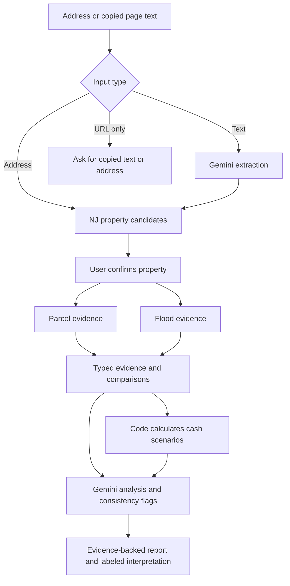

# BidWise — Technical Specification

Implements the approved `scope.md` and `prd.md`. Approved by the learner on October 19, 2026, with "looks good" after technical review. Implementation is in progress; see `docs/data-feasibility.md` for observed coverage and pending checks. Preserve all approved functionality, including Gemini extraction AND analysis. On October 20 the learner authorized continuing independent source/report/map work while live Gemini generation remains unavailable. AI acceptance stays pending; no provider switch or feature cut. The accompanying URL Context question adds a bounded investigation, not universal URL support.

## How This Works, In Plain Language

The website has a browser interface and a server-side part in one project. The browser shows the map, evidence and editable scenarios. The server keeps secret keys private and requests outside information.

An address goes straight to property matching. Copied page text first goes to Gemini to pull out useful claims and the exact words supporting them. The user confirms the property before its records are combined. Published NJ services supply available parcel and flood evidence.

Ordinary code compares genuinely comparable claims and calculates renovation, resale and rental results. Gemini then reads the available evidence and calculation results to explain their meaning, flag potential inconsistencies and suggest remaining questions. Both input paths receive this analysis. The AI's interpretation is labeled separately from records and assumptions; its agreement is a supplementary check, not proof of correctness.

Changing assumptions updates the numbers immediately. AI commentary records which version of the numbers it reviewed; changed inputs mark that commentary outdated until refreshed. A provider outage leaves usable evidence and calculations visible, with a clear unavailable status for the failed part.

## The Core Journey Through the System

Implements `prd.md > The Core Journey`.

1. Validate the input as an address, pasted text or unsupported link. Links receive the approved copy-text/address fallback without fetching the website.
2. For pasted text, call `/api/parse` using Gemini structured output; retain possible target properties and supported claim snippets, ignoring page clutter. Address entry skips this extraction call only.
3. Call `/api/identify` for property candidates. User confirms the address/parcel identity; no semantic guess silently joins properties.
4. Fetch `/api/records` and `/api/hazards` in parallel with separate statuses and timeouts. Display the map and available evidence progressively.
5. Compare claims in code and calculate any complete financial scenarios.
6. Call `/api/analysis` for Gemini property analysis even if financial assumptions are still missing. Supply available evidence, typed comparisons, valid numerical results, unavailable checks and explicit unknowns.
7. Render grounded analysis with source links and a snapshot identifier. Reject unsupported references/structured claims; do not silently adopt model-invented records or numbers.
8. Recalculate locally on edits. Show an outdated-analysis label and a **Refresh AI analysis** action when the reviewed inputs differ; refresh analysis of the current snapshot on request. Initial analysis runs automatically after the first report is assembled.



## Stack

Carry forward v3's existing approach; these are recommendations for agreement through this specification review, not claims of installed compatibility.

| Piece | Choice and reason | Official documentation |
|---|---|---|
| Runtime | Node.js 24 LTS as the reproducible target; installed Node 26 is an observed local runtime, not the version yet validated for the build | [Node releases](https://nodejs.org/en/about/previous-releases) |
| Application | Next.js App Router, React and TypeScript: browser UI and server routes in one repository | [Next.js setup](https://nextjs.org/docs/app/getting-started/installation), [React](https://react.dev/learn), [TypeScript](https://www.typescriptlang.org/docs/) |
| UI | Tailwind CSS and selected shadcn/ui primitives for forms, cards and popovers; CSS transitions for motion | [Tailwind for Next.js](https://tailwindcss.com/docs/installation/framework-guides/nextjs), [shadcn/ui](https://ui.shadcn.com/docs) |
| Charts | Recharts for the resale sensitivity chart | [Recharts](https://recharts.github.io/en-US/) |
| Mapping | Mapbox GL JS, flat map with custom house SVG | [Mapbox GL JS](https://docs.mapbox.com/mapbox-gl-js/guides/) |
| AI | Official `@google/genai`, with separate structured extraction and analysis operations | [SDK](https://ai.google.dev/gemini-api/docs/libraries), [structured output](https://ai.google.dev/gemini-api/docs/structured-output) |
| Validation | Zod at input, provider, AI and report boundaries | [Zod](https://zod.dev/) |
| Verification | Vitest for domain/adapters and Playwright for actual browser behavior | [Vitest](https://vitest.dev/guide/), [Playwright](https://playwright.dev/) |

Use current compatible stable releases at build setup, record exact versions in `package-lock.json`, and document the tested runtime. Do not guess release numbers or install prereleases silently. No database, login, scraping subscription or additional orchestration framework is needed by this approved slice.

## Where It Runs and How Someone Tries It

Implements `prd.md > What We're Building` and `States and Boundaries`.

Repository root: `/Users/mani/current_projects/BidWise/app`. Develop and record locally first. The intended setup once code and lockfile exist is:

```bash
cd /Users/mani/current_projects/BidWise/app
npm ci
cp -n .env.example .env.local
npm run dev
```

The copy command preserves an existing environment file. Configure it using local account tools, never credentials pasted into chat. Open `http://localhost:3000`. Commands to implement and verify: `npm run lint`, `npm run typecheck`, `npm test`, `npm run test:e2e`, `npm run build`; production smoke run uses `npm start` after a successful build. README will give clone-relative equivalents for other machines.

Required environment: `GEMINI_API_KEY`, `GEMINI_MODEL`, `NEXT_PUBLIC_MAPBOX_ACCESS_TOKEN`. Server keys stay server-only. Mapbox's public token has the least necessary permissions and origin restrictions where available; card-free trial token options must be verified. NJ endpoints are server-owned configuration, never client-supplied destinations.

Use an available free-tier Flash-class model that passes BOTH extraction and analysis checks. Current documentation demonstrates `gemini-3.8-flash`; account access, quota and quality remain unverified. A cheaper model is not an automatic substitute. Confirm model name in AI Studio before the build-stage test, and keep it configurable.

Public repository and short public video remain required. Optional deployment is not selected here. If later requested, verify provider budgets, key handling, request caps and judge availability before distributing the URL. Preserve the existing remote README/history when integrating the local unborn branch; no reset, overwrite or force-push.

## Look and Feel

Implements `prd.md > Look and Feel` and `Screens and Layout`.

Updated by the user on October 26: light warm background, vibrant coral actions, lilac/mint panels and dark readable text. Pill-shaped buttons/navigation/status labels, 24 px rounded cards, locally served variable DM Sans body text and Manrope headings, and labeled Lucide icons. Keep copy concise; put the detailed coverage list behind a native disclosure without hiding identity conflicts or source failures. Use consistent spacing and tabular financial numerals. Desktop uses map-left/basic-details-right, followed by detailed evidence, renovation and separately labeled resale/rental sections. Stack naturally on mobile without horizontal overflow.

Smooth short transitions are for useful state changes, never simulated progress or a constantly moving marker. Honor reduced motion. Keep map pitch/bearing zero, retain attribution and use a 28–36 px shaded house SVG. Use accessible text labels in addition to color. Information buttons support keyboard, touch, focus and Escape dismissal; technical terms receive short explanations.

## Components

### Property Input

Implements `prd.md > Property Input and Identity`. `PropertySearch` accepts an address or manually pasted visible page text. Proposed disclosed limit: 50,000 characters, enforced consistently in UI/server; do not silently truncate. The server also caps request size. Link-only input shows the copy-text/address fallback and preserves what was entered. Ask only for missing identity or necessary disambiguation, not a mandatory long questionnaire.

October 20 learner review addition: address autocomplete uses the existing public NJGIN `suggest` operation, with no paid search provider or API key. Wait 350 ms after typing, require 4–200 characters, request at most five address suggestions, cancel superseded requests, support keyboard/touch selection and manual search during outages. Anchor the dropdown directly below the textbox, cap the suggestion-list height and allow scrolling; keyboard navigation scrolls the active option into view. On mobile the suggestion list stays immediately after the textbox and before the submit button, with focus handling that preserves manual search. A suggestion only fills the address; normal parcel matching and explicit confirmation still follow. The NJ index has coverage gaps and no availability guarantee. Address suggestions do not replace the approved copied-page path. Its interface and validation are implemented as of October 22; full live Gemini quality acceptance remains pending.

### Gemini Extraction

Implements `prd.md > Property Input and Identity`. Server-only `parse` route extracts at most a bounded set of candidates, each with property identifiers, typed price mentions, condition claims and supporting snippets. Every non-null extracted claim requires a snippet that appears in the supplied text and is attributable to that target's context; if attribution is unclear, mark it ambiguous rather than borrow a value from a related listing. Reject or mark unsupported claims rather than invent support. Do not combine similar houses in related-listing sections. Input instructions are untrusted data; no browsing, tool execution, URL fetching or private-file access is provided to this model operation.

October 22 internal compatibility correction: omit `maxItems` from the provider-facing JSON Schema while preserving all local Zod limits and quotation checks. Conservative multi-target address-region checks reject cross-target snippets; noisy/adversarial real-page acceptance remains pending. Authenticated 15-minute candidate receipts bind validated claims to the confirmed identity digest. This adds no persistence or website fetching. See `docs/gemini-reliability-check-2026-10-22.md`.

### Identity and Confirmation

Implements `prd.md > Property Input and Identity`. Address geocoding yields candidates, not confirmation. Match parcel identity using actual source identifiers and municipality context. Unit/condo/qualifier ambiguity remains visible. A clear confirmation action freezes the selected identity for the report. A new property cancels pending requests and invalidates the previous report/analysis.

October 20 learner review: expand the property report beyond the initial headline subset. Show every useful non-personal property field available from the parcel source, grouped by identity, building/use, land, valuation/tax and deed history. Preserve absent values and shorthand/code caveats; do not treat owner mailing ZIP/address as property location. Decode only documented tax classes. Learner refinement: display valid NJGIN YYMMDD deed dates with a full four-digit year, e.g. October 10, 2018. Interpret the century using the most recent matching year not after the retrieval year, validate the resulting calendar date, retain the original source string, and disclose the inference in Source details with a short inline label. Historical deeds can be a century older; this interpretation is not independent verification.

### Parcel Records Adapter

Implements `prd.md > Property Summary and Map` and `Detailed Evidence and Analysis`. A provider adapter maps observed official fields into canonical evidence. Query by confirmed identifiers; coordinate intersection alone must not silently select among ambiguous units/parcels. Field mapping is established by build-stage samples, not presumed from names. Beds/baths/interior area are not automatically MOD-IV facts. Respect owner-name redaction; do not fetch or display protected identities.

Retain the approved basic-field checklist: parcel ID, municipality, block/lot/qualifier, property class, assessment, last recorded sale, historical tax and year built when the source actually supplies them. Attach source/as-of dates and sale/history dates where available; missing dates and attributes stay explicitly unavailable. Recorded history includes only returned, dated evidence, with no promise of a complete history search.

### Flood Adapter

Implements `prd.md > Detailed Evidence and Analysis`. Query the documented flood polygon layer for the confirmed coordinates, retaining geocode precision and the matched zone evidence. No polygon returned, source failure, uncertain location and an actual returned zone are distinct outcomes. Withhold or qualify a conclusion if location is uncertain; never infer no flood risk from an empty response.

### Evidence and Claim Comparison

Implements `prd.md > Detailed Evidence and Analysis`. A shared `Fact` presentation renders value, evidence class, verification status, source, source date/check time and caveats. Comparisons operate on the same property, attribute kind, unit and applicable time frame. Outcomes are matches, differs, cannot verify or not comparable. Asking price versus assessed value is not a discrepancy. Unsupported fields stay unknown.

October22 learner-requested starting-value change: add property-specific editable estimates with visible provenance/basis, dates, uncertainty and strict property/revision binding. Preserve user edits when estimates arrive; do not substitute assessment/nominal sale for a proposed purchase or invent missing interior/condition facts. Deterministic math remains unchanged. This refinement is implemented mechanically as of October23; source-based prefills are live-proven and real Gemini allowance quality remains pending. See `docs/starting-estimates-checkpoint-2026-10-23.md`.

### Starting Estimates

Implements the October22 learner refinement in `prd.md > Renovation and Cash Scenarios`. After confirmed identity/source loading, `/api/estimates` sources stage fills canonical historical tax, unambiguous quoted purchase asking price or advertised monthly rent and dated local tract benchmarks where appropriate, then its model stage requests provisional cost ranges only if no matching validated estimate set exists. US Census tract lookup and independent Census Reporter ACS2024_5yr B25077/B25058 provide area benchmarks; the direct Census data request required a key here. No new account/payment. Explicit one-residential-dwelling/precise-location gates avoid mixing per-unit rent with multi-unit whole-property values. Source period, MOE, suppression and missing-data checks remain visible; no appraisal/current-price claim or automatic renovation uplift.

Illustrative fee/schedule/vacancy/management/contingency values are labeled planning choices; model-only allowances have typed fields, numeric ranges/caps and evidence IDs. HOA dues and investor target profit cannot be invented. Inputs are editable. Replies are bound to confirmed PIN/revision and substantive record evidence; user edits, clears and repair-row changes survive late replies and refresh. Restore explicitly replaces available starting values. Same-confirmed-PIN in-page drafts preserve edited/cleared fields across a new search, with a ten-parcel cap and no transfer to another parcel or persistence across reload. Quoted monthly rent needs an explicit monthly period and is never substituted for a purchase price; nonfinite copied amounts are withheld. Failed AI preserves source seeds. Analysis follows the current inputs and treats reported starting-value origins as untrusted context, recomputing numbers server-side. See the checkpoint for exact call bounds and acceptance.

### Renovation Engine

Implements `prd.md > Renovation and Cash Scenarios`. Keep v3's editable quantity × low/base/high unit costs, contingency and separate unknown-condition reserve. The estimates are illustrative/user assumptions, never certified quotes or model-discovered physical defects. Compute at full numeric precision; round for display. Shared renovation changes update both scenarios.

For each low/base/high case: `line_cost = quantity * unit_cost`; `renovation_total = sum(line_costs) * (1 + contingency_fraction) + unknown_condition_reserve`. The resale engine's `R` is this total, including both allowances exactly once. Labels and tests must prevent adding them again downstream.

### Cash Resale Engine

Implements `prd.md > Renovation and Cash Scenarios`. Retain v3 §7 cash formulas. With purchase `P`, buyer fraction `b`, fixed buyer costs `Fb`, renovation `R`, months `H`, monthly carry `C`, entered resale `S`, seller fractions `c,s`, fixed seller costs `Fs` and target profit `T`:

```text
project_cost = P*(1+b) + Fb + R + H*C
selling_costs = S*(c+s) + Fs
profit = S - selling_costs - project_cost
ROI_on_cost = profit / project_cost                  # only when denominator > 0
break_even_sale = (project_cost + Fs) / (1-c-s)
max_bid = (S*(1-c-s) - Fs - Fb - R - H*C - T) / (1+b)
```

Missing required inputs keep the scenario incomplete. Require finite nonnegative monetary inputs, fractions and durations; require `c+s < 1`. Distinguish null from explicit zero. Negative max-bid numerator means no nonnegative bid meets the chosen target, not a recommended negative bid. Do not conflate an opening bid or judgment with the user's proposed purchase price.

Base uses entered values/base rehab. Downside carries v3's editable stress assumptions: high rehab, resale 10% lower, hold three months longer and seller percentage one point higher; validate the resulting fractions. These are stress assumptions, not regional forecasts. No annualized ROI, mortgage or automatic buy/sell instruction.

`FlipScenario` owns an accessible Recharts profit-versus-resale-price sensitivity chart computed with this same engine. Varied resale prices are labeled assumptions, not predicted market prices. Withhold the chart for an incomplete/invalid scenario and provide a readable textual alternative. Show each case's profit, break-even, scenario maximum bid and difference from the entered proposed purchase price.

### Basic Cash Rental Engine

Implements `prd.md > Renovation and Cash Scenarios`. Inputs are expected monthly rent, vacancy/lost-rent fraction, annual property-tax assumption, annual insurance, annual owner-paid utilities/HOA, annual maintenance allowance, management fraction and a separate annual capital-repair reserve. Required unknowns remain null until supplied or explicitly set to zero/not applicable.

```text
effective_annual_rent = 12 * monthly_rent * (1-vacancy_fraction)
management_expense = effective_annual_rent * management_fraction
operating_expenses = annual_tax + annual_insurance + annual_owner_utilities
                   + annual_HOA + annual_maintenance + management_expense
annual_operating_income = effective_annual_rent - operating_expenses
annual_cash_after_reserve = annual_operating_income - annual_capital_reserve
monthly_cash_after_reserve = annual_cash_after_reserve / 12
```

Show the reserve separately so it is not silently counted twice. Label outputs before income tax and without debt service, for a cash-purchase scenario. Vacancy and management fractions must each be in `[0,1]`; other inputs must be finite and nonnegative. Negative outputs remain visible. Historical tax records are evidence, not a forecast of next year's bill. Do not auto-invent rent, management charges or insurance. Shared purchase/renovation inputs provide acquisition/renovation context; no complete rental project-budget claim without all relevant costs. Do not compare one-time sale profit and annual rental cash as if they had the same time horizon.

### Gemini Analysis and Supplementary Review

Implements `prd.md > Detailed Evidence and Analysis` and `Renovation and Cash Scenarios`, including the learner's explicit technical clarification.

`/api/analysis` builds a canonical evidence/scenario snapshot on the server, computes the comparisons and financial outputs with shared domain code, then invokes Gemini. Client-supplied text remains user/listing claims; the server never accepts an `official_record` label merely because a browser submitted it. Official evidence comes from server provider adapters. Reuse a short-lived server-side public-response cache where appropriate, or fetch again; cache is an optimization, not an authorization or permanent-history mechanism.

Provide only the identified evidence, supported claims, deterministic calculations, assumptions and actual missing checks. Ask for a structured summary, findings referencing allowed evidence IDs, scenario implications, unanswered questions and consistency flags. Validate allowed IDs, referenced values and numeric claims before display. Semantic prose still requires testing/human review; schema validity alone cannot establish truth. The AI may flag a suspected calculation/source mismatch, but must never silently replace the value. Surface unresolved flags for investigation.

Initial analysis runs even when scenarios are incomplete, explaining the evidence and missing assumptions. A successfully grounded analysis includes an input/evidence hash and retrieval timestamps. After edits, numbers update immediately, old AI analysis is labeled outdated, and **Refresh AI analysis** requests commentary for the new snapshot. Never present an earlier favorable interpretation as current after changed costs or evidence. Identical snapshot reuse avoids duplicate calls without cutting the analysis feature.

The analysis response includes its canonical evidence, comparisons, calculated results and user-input revision, not just detached commentary. Apply it consistently only if the selected property and user-input revision still match the current browser inputs; otherwise discard/label the superseded response. If refreshed official evidence differs, update the report and analysis snapshot together with the new retrieval times. Never pair commentary about newly fetched records with an older displayed evidence panel while claiming they are the same snapshot.

If Gemini errors, is rate-limited or fails validation, show **AI analysis unavailable** and preserve available evidence/numbers. Do not silently substitute a template and claim AI analysis succeeded. Extraction and analysis have separate bounded request/retry accounting; no infinite retry, per-keystroke calls or unapproved paid/model fallback.

### Map and Basic Summary

Implements `prd.md > Property Summary and Map`. Lazy-load the map after client rendering, maintain one map instance per mounted view, move the confirmed marker without rebuilding the map, and preserve required provider attribution. Candidate locations are explicitly candidates. Map failure leaves textual identity, evidence and calculators usable. No fabricated property marker in the first-use state.

### Accessible Explanations and Before-Purchase Checks

Implements `prd.md > Screens and Layout`, `Look and Feel`, and `States and Boundaries`. Reuse a single help/popover primitive for definitions, source details and caveats. Include the approved remaining-checks board for inspection, title/liens, occupancy, auction terms, taxes, insurance and other unsupported information. These are research prompts, not completed searches or legal certifications. Report/scenario section links and Print report help navigate and retain the full report. AI references use readable source labels linking to existing report sections; sanitized request diagnostics are separate. Invalid amount/percentage fields have associated inline errors; cancellation/network failure preserves entered text. Search locks its active input while processing, confirmation receives keyboard focus, and map failure has a scoped retry. Keep readable touch targets, narrow-screen reflow, reduced motion and printable source/assumption content; print retains each field's source link, dates, raw value when present and caveat even when its screen popover is closed.

## Data Model

Carry forward v3 §6 and extend with `RentInputs` and `AnalysisSnapshot`.

- `InputDraft`: type, manually supplied text/address and optional untrusted source URL. Browser memory only; no raw text in URLs, console logs or public fixtures.
- `ExtractedPropertyCandidate`: address/municipality/block/lot/qualifier, nullable claims, typed price mentions and exact snippets. Stored in the current browser session's memory; never official by extraction alone.
- `PropertyIdentity`: canonical municipality/parcel identifier and qualifiers, normalized address, coordinates and source match precision. Confirmed selection controls all downstream requests.
- `Evidence`: stable ID, nullable value/unit, class (`official_record`, `seller_claim`, `user_assumption`, `calculated`, `ai_inference`), status (`verified`, `unverified`, `conflicting`, `stale`, `not_available`, `not_checked`), source URL/record ID, source date, fetched time and caveat. Verified means matched to a source, not inspected physically.
- `ClaimComparison`: comparable attribute kind, the two evidence references, outcome and deterministic reason.
- `FlipInputs`, `RentInputs`, `RenovationInputs`: nullable editable values with explicit assumptions and validation errors; ordinary code produces results or typed incompleteness.
- `AnalysisSnapshot`: confirmed identity, available evidence, comparisons, assumptions/results, unavailable checks, hash, generated time, model identifier and validated AI findings. Current, outdated and unavailable are distinct UI states.

P0 keeps input and financial assumptions in memory; refresh/navigation may clear them. Public parcel identifiers may be placed in a URL to refetch records, but private text, raw responses, credentials and full financial scenarios are not serialized there. No durable history, saved accounts or shareable scenario promise is introduced. Server caching is public-data-only, short-lived and optional; user text is not persisted by the application.

## File Structure

All application paths are relative to the Git root `BidWise/app/`; `src/app` is the Next.js application folder, not the parent planning workspace.

```text
app/
├── src/
│   ├── app/
│   │   ├── layout.tsx, page.tsx, globals.css    # workspace shell/input
│   │   ├── property/page.tsx                  # report for confirmed parcel
│   │   └── api/
│   │       ├── parse/route.ts                 # Gemini extraction
│   │       ├── identify/route.ts              # candidates and identity
│   │       ├── records/route.ts               # parcel evidence
│   │       ├── hazards/route.ts               # flood evidence
│   │       └── analysis/route.ts              # canonical snapshot + Gemini analysis
│   ├── components/
│   │   ├── input/PropertySearch.tsx
│   │   ├── property/PropertyConfirmation.tsx
│   │   ├── property/PropertySummary.tsx
│   │   ├── property/ClaimVsRecord.tsx
│   │   ├── property/UnknownsBoard.tsx
│   │   ├── property/PropertyAnalysis.tsx
│   │   ├── research/Fact.tsx
│   │   ├── finance/RenovationEstimator.tsx
│   │   ├── finance/FlipScenario.tsx
│   │   ├── finance/RentScenario.tsx
│   │   ├── map/PropertyMap.tsx, HouseMarker.tsx
│   │   └── ui/InfoTerm.tsx                    # reusable accessible explanations
│   └── lib/
│       ├── providers/gemini.ts, njgin.ts, njdep.ts
│       ├── providers/http.ts                  # bounded requests/cache/status
│       ├── property/match.ts, normalize.ts, claims.ts, evidence.ts
│       ├── finance/renovation.ts, flip.ts, rent.ts
│       ├── analysis/snapshot.ts, validate.ts
│       ├── schemas/input.ts, listing.ts, property.ts, report.ts
│       └── glossary.ts
├── tests/
│   ├── finance/, match/, claims/, analysis/, adapters/
│   ├── e2e/                                  # real browser workflow/mobile
│   └── fixtures/                             # permitted public samples, provenance
├── docs/data-feasibility.md                   # build-stage endpoint/sample evidence
├── devpost/                                  # approved planning + build/ship artifacts
├── public/                                   # original/permitted static assets
├── .env.example, .gitignore, .nvmrc
├── package.json, package-lock.json, tsconfig.json
├── vitest.config.ts, playwright.config.ts
└── README.md, LICENSE, THIRD_PARTY_NOTICES.md
```

## External Services and Dependencies

The following endpoint metadata/documents were inspected; no real-property query, Gemini call, account-limit verification or permission to republish a chosen demo listing is established yet. The mandatory first build milestone verifies real payloads before coding UI around assumed fields.

### Gemini API

Use official SDK with server key and `GEMINI_MODEL`. The documented structured-output API currently exposes `POST https://generativelanguage.googleapis.com/v1beta/interactions`, with model, input and a JSON response format/schema; use its corresponding supported SDK method after validating installed compatibility. No web-search/URL-context tools enabled. Extraction response maps candidates/claims/snippets; analysis maps grounded findings/questions/flags. Do not mix in legacy SDK examples without checking compatibility.

[SDK](https://ai.google.dev/gemini-api/docs/libraries), [structured output](https://ai.google.dev/gemini-api/docs/structured-output), [pricing](https://ai.google.dev/gemini-api/docs/pricing), [limits](https://ai.google.dev/gemini-api/docs/rate-limits). Free access/actual quota is model/project dependent, and free-tier content may be used for product improvement. Use public material only. Track extraction and analysis usage separately. No unsupported fixed calls/day or universal credit balance is promised.

October22 learner-selected availability refinement: keep3.8 preferred and allow the configured free3.5 Flash-Lite fallback only after two primary503 responses. One fallback attempt, no SDK retries, same45-second per-attempt limit and local schema/evidence guards. No failover on quota/auth/timeout/network/bad-request/invalid-output failures. Maximum three calls per operation; disclose actual model/fallback origin. `GEMINI_FALLBACK_MODEL` can disable it; only the currently verified, approved free fallback is allowed. See `docs/gemini-api-diagnosis-2026-10-22.md`. This does not establish complete live semantic acceptance or continuous availability.

### Gemini URL Context Feasibility Investigation

At the learner's request, investigate [Gemini URL Context](https://ai.google.dev/gemini-api/docs/url-context) during the first build spike. It retrieves page content, potentially from cache, provides retrieval/citation metadata and counts fetched text toward input usage. Public accessibility and site permission still matter.

Test permitted, allowlisted sources; record retrieval status, cited URL, freshness limits, extraction quality, SDK/model compatibility and usage. Model-written snippets require source checking. Keep copy/paste/address fallback and never claim a failed URL was read. This authorizes investigation; enabled URL behavior must follow observed access/rights and corresponding PRD/spec reconciliation, without weakening evidence rules.

### NJGIN Geocoding

Documented base: `https://geo.nj.gov/arcgis/rest/services/Tasks/NJ_Geocode/GeocodeServer`. Candidate operation: `/findAddressCandidates`, with server-encoded input, `f=json`, `outSR=4326` and only necessary output attributes. Confirm the advertised single-line parameter and returned address/score/location/precision fields during the build-stage spike rather than assume a field mapping.

[Official service](https://geo.nj.gov/arcgis/rest/services/Tasks/NJ_Geocode/GeocodeServer), [NJGIN documentation](https://www.nj.gov/njgin/edata/geocoding/). Public metadata access is verified; exact query behavior, rights, limits and match suitability remain to test. No paid geocoder is silently introduced.

### NJGIN Parcel/MOD-IV

Documented base: `https://services2.arcgis.com/XVOqAjTOJ5P6ngMu/arcgis/rest/services/Parcels_Composite_NJ_WM/FeatureServer`, item `533599bbfbaa4748bf39faf1375a8a9c`, layer `0` (`Cad_parcel_mod4`). Query `/0/query` by verified identifiers or bounded spatial intersection, using `f=json`, necessary `outFields`, `outSR=4326` and explicit geometry options. Never interpolate raw text into SQL filters; encode/validate supported identity values on the server. Map actual provider attributes into the canonical schema after sample verification. Omit protected owner fields.

[Service metadata](https://services2.arcgis.com/XVOqAjTOJ5P6ngMu/arcgis/rest/services/Parcels_Composite_NJ_WM/FeatureServer), [official parcel page](https://nj.gov/njgin/edata/parcels/). Metadata lists a 2,000-record response maximum, not a guaranteed requests/day quota. County freshness, joins and unsupported fields need explicit coverage notes.

### NJDEP/FEMA Flood

Documented layer: `https://mapsdep.nj.gov/arcgis/rest/services/Features/Hydrography/MapServer/43`. Candidate `/query` uses confirmed `x,y`, point geometry, `inSR=4326`, intersection relation, necessary zone fields, `returnGeometry=false`, `f=json`. Retain multiple matches, precision and source timestamps. Layer metadata identifies `FLD_ZONE`; confirm the full response contract in the real-property spike. [Layer documentation](https://mapsdep.nj.gov/arcgis/rest/services/Features/Hydrography/MapServer/43).

### Mapbox

Use Mapbox GL JS/styles with the configured public token and required attribution. No Mapbox geocoding is selected; matching uses NJGIN. [Map library](https://docs.mapbox.com/mapbox-gl-js/guides/), [map-load rules](https://docs.mapbox.com/mapbox-gl-js/guides/pricing/), [account/trial rules](https://docs.mapbox.com/accounts/guides/signup/), [pricing](https://www.mapbox.com/pricing).

Card-free trial documentation currently lists 5,000 web-map loads/month; standard pricing lists 50,000 free followed by overages. Trial duration, remaining allowance and token restrictions need account verification. A billing alert is not a hard cap. No card, paid upgrade or new provider is authorized by this draft.

## Important Failure Modes

- **Unusable/ambiguous input or wrong parcel:** preserve input and ask for correction/confirmation; no downstream cross-property merge.
- **Unavailable/partial source data:** show the real successful evidence, missing checks and timestamps; do not substitute invented records or treat an empty flood response as safety.
- **AI invalid, stale or rate-limited:** separate extraction/analysis status; bounded failures with clear retry/manual-address paths; numeric/report features remain usable. Do not claim the AI step completed if it did not.

Default request plan: public-service timeout 15 seconds, AI timeout 45 seconds, at most one retry for eligible transient failures, no automatic quota-error loop. Abort superseded requests and reject stale responses. Verify these settings against the actual model, runtime and any later chosen host before deployment.

All outbound destinations are fixed server configuration; source URLs and pasted instructions do not control requests. Keys/raw input are excluded from logs, error responses, client bundles and Git. Before public sharing, verify host-level abuse/request controls and account settings; in-memory counters alone are not a reliable serverless spending limit.

## Verification and Evidence

Implements the observable criteria in all PRD behavior headings.

1. **Data feasibility first:** after `5-build` is reached, investigate 2–3 authentic NJ inputs, identify one repeatable demo, and record exact URLs/layer IDs/fields, precision, source dates, permissions and gaps. Test Gemini extraction AND analysis on authentic permitted material plus a malicious-instructions fixture. No claims of integration readiness from endpoint metadata alone.
2. **Domain tests:** financial guards/round trips, null-versus-zero, claim types/units/time, multiple-property ambiguity, unavailable/stale sources and unsupported numeric/ID claims in AI results. Domain calculations remain independent of AI.
3. **Hand fixture:** `P=100000,b=0,Fb=5000,R=25000,H=6,C=1000,S=200000,c=.05,s=.02,Fs=2000,T=30000` gives project cost `136000`, selling costs `16000`, profit `48000`, break-even `138000/.93`, max bid `118000`. Substituting max bid returns profit `30000`. Rehab fixture can be base items `20000`, explicit zero contingency and reserve `5000`.
4. **Rental fixture:** monthly rent `2000`, vacancy `.05`, annual tax `3600`, insurance `1200`, utilities/HOA explicitly zero, maintenance `1200`, management `.10`, annual capital reserve `1800` gives effective rent `22800`, operating expenses `8280`, operating income `14520`, cash after reserve `12720/year` and `1060/month`. These are test numbers, never live property data.
5. **Actual browser checks:** confirmed input-to-report flow; copied page clutter and multiple properties; real source plus AI partial failures; edit-to-recalculation; sensitivity-chart/text values agree with the engine and respond to resale-price changes; outdated/refresh analysis behavior; mobile/no-overflow; keyboard/touch/focus/reduced motion.
6. **Fresh install/release:** document exact runtime, lockfile and startup, run production build/smoke, inspect actual rendered UI, scan intended files/history for secrets and private content, preserve required skill docs and notices. Do not run every normal test against live Gemini or publish unlicensed payload fixtures.

## What Was Simplified and Why

These are approved scope boundaries, not new cuts: no accounts/database, no mortgage models, manual public-text/address input rather than automatic restricted-site import, manual market assumptions and one NJ property at a time. Retain Gemini extraction plus analysis, both cash scenarios, original map/layout, source comparisons and all approved P0 behavior. Appendix A remains the future register.

Usage management means bounded requests, identical-snapshot reuse and explicit quota/cost reporting. It is not permission to remove features, choose a lower-quality model solely for price, switch paid tiers or replace the core with fixtures.

## Decisions and Open Issues

- Learner approved scope and PRD and explicitly reaffirmed Gemini text processing AND property/scenario analysis with supplementary checking. No re-interview of settled product/style choices is needed.
- Learner asked how the tools work and their credit/scraping limits. `tooling-and-limits.md` records current documentation and the corrected call roles. Explanation has been supplied; account configuration and hands-on learning have not yet happened.
- Next.js/TypeScript, official Gemini SDK, official NJ sources, Mapbox and deterministic calculations follow the existing v3 technical approach. This complete draft awaits learner agreement, not individual per-file decisions.
- The proposed initial-analysis/explicit-refresh behavior and disclosed 50,000-character limit are derived technical choices for review. They preserve the approved immediate numeric recalculation and grounded AI analysis requirements.
- **Before live calls:** verify actual account/model access, quotas, billing settings, map trial expiry/permissions and consent for any paid changes. Never request secrets in chat or use an unrelated available key just because it exists.
- **Build-stage gates:** verify real provider contracts, source licensing, model extraction/analysis quality, runtime/package compatibility and real-property coverage; record evidence before relying on them. If an integration cannot meet the approved behavior, explain the measured limitation and seek a material decision instead of quietly cutting it.
- **Resolved:** learner approved this specification. `5-build` still establishes approved build order and selected mode before implementation, followed by required hands-on checkpoints, verified milestones, final review and learning wrap-up/app map. Spec approval does not claim any feature is built or submission-ready.

Independent read-only specification review completed before learner review. No blocking scope contradiction found; retained basic/history fields, sensitivity-chart behavior, renovation allowance accounting and rental fraction guards were made explicit. No external integration or model quality was certified by this document review.


## October 26 — learner-authorized free Groq trial

The learner explicitly asked for a free alternative, supplied a Groq key locally and said “lets try that.” This supersedes the earlier Gemini-only provider restriction for the trial while retaining both extraction and analysis and all financial functionality. `AI_PROVIDER=groq` selects Groq GPT-OSS120B for extraction, property/scenario analysis and provisional cost allowances; `AI_PROVIDER=gemini` preserves the existing Gemini3.8→503-only3.5 behavior. A key alone never selects a provider. No automatic cross-provider fallback, paid tier or billing change is authorized. Shared instructions and unchanged local validators apply to both providers. See docs/groq-trial-2026-10-26.md.


## October26 — consolidated analysis and numeric references

The learner requests a consolidated research judgment, supporting implications and prioritized next checks. Shared instructions and the analysis presentation now implement that format using the existing result contract. Scalar numeric assumptions are available alongside their original context. Groq's private wire format selects exact ID=value reference tokens from a constrained enum, resolves them to the existing numeric-claim objects and runs the unchanged exact-value/reference validator. Unknown/rounded/wrong references remain rejected. No provider switch, extra retry, unconditional purchase verdict or automatic strategy choice was added. See `docs/analysis-fix-2026-10-26.md`.


## October26 — stable AI cost estimates

The learner reports that repeated research produces different renovation and other AI allowances for the same property. Save the first locally validated allowance result and reuse it for unchanged property/evidence/provider/method inputs. Bind the set to confirmed PIN, substantive records/dates, area geography/period/statistics, canonically ordered supplied claims, configured provider/models, allowance instruction and schema version. Exclude confirmation tokens, revision, retrieval clocks and API keys from that identity. A source-first cache hit returns the full set without another model operation; the UI retains edits, original generation time and a reused/saved label.

Store only validated generated allowance outputs and the opaque digest in ignored `.bidwise-cache/estimates`, not raw pages, request bodies, credentials or user scenario drafts. This small server file store adds no account or database. Revalidate reads, coalesce in-process duplicates and atomically publish a single winner. Do not replace a corrupt/unwritable set with a different AI draw. Provider/validation failures remain retryable and are not saved. No automatic expiry or random regeneration on refresh; changed evidence/method creates a distinct set. The local directory must survive restarts; any multi-instance/public deployment requires durable shared storage before promising the same behavior. Reuse is consistency, not factual certification or a contractor quote.
